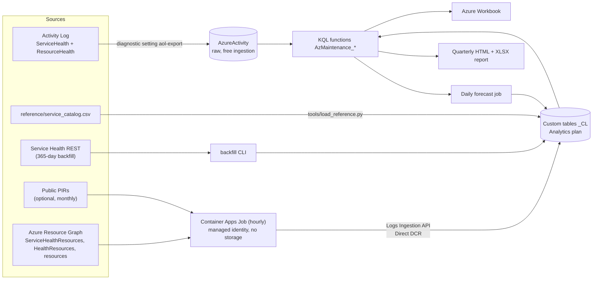

# Azure Maintenance Ledger

A low-cost utility, deployed in the customer's own tenant, that keeps a **durable ledger** of Azure Service Health events, Resource Health downtime and public Azure PIRs, separates **planned from unplanned** and **exposure (event window) from downtime (resource unavailable)**, and reports **observed availability against SLA** plus an **evidence-based expected-downtime range** (P50/P90 per year, always with sample size, window and confidence).

Azure itself only keeps 90 days to 1 year. The ledger keeps 730 days by default. Front end: an Azure Workbook plus a quarterly static HTML/XLSX report.

> Planning ranges are evidence from history, not a forecast or a guarantee. Read [docs/method.md](docs/method.md) and the caveats below before quoting numbers.

## One-click deployment

[](https://portal.azure.com/#create/Microsoft.Template/uri/https%3A%2F%2Fraw.githubusercontent.com%2FSaby007%2Fazure-maintenance-ledger%2Fmain%2Finfra%2Fazuredeploy.json)

Click the button, sign in, pick the subscription and a region, review the parameters and select **Review + create**. One deployment creates, in your own subscription:

| What | Detail |
|------|--------|
| Resource group | `rg-azure-maintenance-ledger` (name is a parameter) |
| Log Analytics workspace + 9 custom tables | dedicated, 730-day retention, 0.5 GB/day cap |
| Direct DCR | Logs Ingestion API endpoint, no DCE |
| 10 KQL functions + the **Azure Maintenance Ledger Workbook** | ten tabs; open it from Azure Monitor -> Workbooks |
| Collector: Container Apps Job (hourly) | managed identity, **no storage account**, no Application Insights; downloads [release/app.zip](release/app.zip) at each run |
| Roles | Reader on the subscription, Monitoring Metrics Publisher on the DCR, Log Analytics Reader on the workspace |
| Activity Log export | ServiceHealth + ResourceHealth to the new workspace (diagnostic setting `aol-export`) |
| Stale-ingest alert | optional email via `alertEmail` |

The collector job runs hourly at :15 UTC. Its first runs load the service catalog, public PIRs, the Service Health history (365 days through REST), the Resource Health history (89 days), the resource inventory and VM annotations; a step that fails (for example a role still propagating) is retried at the next run. Afterwards each task runs when due (Service Health and inventory daily, VM annotations every 6 h, PIRs monthly, planning ranges daily). **Expect data in the Workbook within about 90 minutes of the deployment finishing**; the *Data health* tab shows progress. The planning ranges appear about an hour after the history is loaded.

Requirements: **Owner** on the subscription (or Contributor plus User Access Administrator), because the template creates role assignments, and the `Microsoft.App`, `Microsoft.Insights` and `Microsoft.OperationalInsights` resource providers registered (they are on by default in most subscriptions).

**Before you click**
- If the subscription already has a diagnostic setting named `aol-export` that points elsewhere, set `activityLogExportName` to another name (the template would overwrite it). Subscriptions are limited to 5 diagnostic settings.
- The collector needs outbound internet access to raw.githubusercontent.com, pypi.org and Azure endpoints. It uses no storage account, so policies that disable public access on storage (common in governed subscriptions) do not affect it.
- The job downloads and runs the code in [release/app.zip](release/app.zip) from this repository at every run. To control updates, fork the repository or pin the `packageUri` parameter to a commit or tag URL.
- Public PIR collection uses an undocumented Microsoft endpoint. Turn `enablePirs` off if that is not acceptable for your organisation.
- More subscriptions: pass them in `additionalSubscriptionIds`, then run `scripts\grant-reader.ps1` and `scripts\enable-export.ps1` for each one (see "Add a subscription").

Rebuild the button's files after changing the source: `az bicep build --file infra\azuredeploy.bicep --outfile infra\azuredeploy.json` and `scripts\build-package.ps1`, then commit `infra/azuredeploy.json` and `release/app.zip`.

## Architecture



Flow: sources -> collectors -> Log Analytics -> KQL functions -> Workbook, report, forecast. Details in [docs/architecture.md](docs/architecture.md).

## What it measures

| Term | Meaning |
|------|---------|
| Unplanned | Service Health `ServiceIssue`, plus Resource Health downtime not explained by a planned event |
| Planned | Service Health `PlannedMaintenance`, or a VM annotation with category Planned |
| Exposure | the event window (impact start to mitigation); **not** downtime |
| Downtime | minutes a resource was Unavailable per Resource Health (user-initiated excluded) |
| Expected downtime | observed history + a P50/P90 planning range with n, window and confidence |

## Deploy from the command line (sandbox or customer tenant)

The button above is the simplest route. For development, or to deploy into an existing resource group, use the scripts. Prerequisites: PowerShell 7, Azure CLI with Bicep, Python 3.11+ (3.13 tested). Sign in with `az login` to an identity that can create resources and diagnostic settings.

```powershell
copy .env.example .env                      # set AOL_SUBSCRIPTION_ID / AOL_RESOURCE_GROUP / AOL_LOCATION
az account show                              # confirm the subscription
.\scripts\deploy.ps1 -WhatIf                 # review
.\scripts\deploy.ps1                         # deploy (prints outputs: workspace id, DCR endpoint, ...)
# put workspace customer id, DCR endpoint and immutable id from the outputs into .env

.\scripts\enable-export.ps1 -WorkspaceResourceId <workspaceResourceId>   # Activity Log export, never overwrites existing settings
python tools\load_reference.py                                           # service catalog (edit reference/service_catalog.csv first)
.\scripts\backfill.ps1                                                   # PIRs, ARG, REST 365 d, Activity Log 89 d, inventory
python -m collector.backfill --only forecast                             # planning ranges
```

Your identity needs Monitoring Metrics Publisher on the DCR to ingest from your machine. For extra subscriptions the collector job needs Reader on each: `.\scripts\grant-reader.ps1 -PrincipalId <collectorPrincipalId> [-Apply]`. The job picks up new code on its next run.

The Workbook is deployed by `deploy.ps1` (Azure portal -> Monitor -> Workbooks -> "Azure Maintenance Ledger"). Viewers need Reader on the workbook and Log Analytics Reader on the workspace.

### Add a subscription

1. Add `{ "id": "<guid>", "name": "<label>" }` to [config/subscriptions.json](config/subscriptions.json).
2. `.\scripts\enable-export.ps1 -WorkspaceResourceId <id>` (checks existing diagnostic settings first; skips at the 5-setting limit).
3. `.\scripts\grant-reader.ps1 -PrincipalId <collector job identity> -Apply` (asks for confirmation).
4. `.\scripts\backfill.ps1` to load its history. The Data health page shows "subscriptions covered vs configured".

### Reports and checks

```powershell
python -m reporting.render_report --days 90            # reports\*.html and *.xlsx (self-contained, no CDN)
python tools\run_kql_checks.py [--synthetic]           # every function + workbook query against the workspace
python tools\seed_fixtures.py                          # synthetic rows (is_synthetic=true) for the checks
python tools\check_idempotency.py                      # two more collector runs add 0 rows to the deduplicated output
.\scripts\cost-report.ps1                              # billable GB and monthly estimate
pytest ; ruff check . ; python tools\build_workbook.py --check
```

Runbook: [docs/runbook.md](docs/runbook.md). Cost: [docs/cost.md](docs/cost.md). Evidence and decisions: [docs/decisions.md](docs/decisions.md).

## Caveats

- History starts when collection starts (plus whatever REST/ARG/Activity Log still hold). See the Data health page for coverage dates.
- Resource Health does not record transitions to Unknown or short blips, and is not a billing-grade availability measure.
- Resource Health intervals that stay open for more than 3 days are treated as stale (usually deleted resources) and excluded; see D-07 in the decisions file.
- Planned/unplanned classification of Resource Health intervals cannot use region (not present on those rows); VM annotations take precedence.
- Public PIRs come from an undocumented endpoint and cover broad-impact incidents only; they are labelled Azure-wide.
- SLA percentages are blank until you supply them with a source URL and verification date.
- The collector runs in a Container Apps Job because policy in governed subscriptions often disables public access on storage accounts, which Azure Functions needs (see D-17 and D-21 in the decisions file). The same collectors run from your machine with `python -m collector.backfill`.

## Uninstall

1. Remove the Activity Log export: `az monitor diagnostic-settings subscription delete --name aol-export --subscription <id> --yes` (leave any other setting alone).
2. Delete the resource group (`az group delete -n <rg>`), which removes the workspace (and the ledger), DCR, Container Apps environment and job, and Workbook.
3. Remove the Reader role assignment created for the job identity (it disappears with the identity, but check the subscription scope).

## Layout

`AGENTS.md` (rules and validated facts) | `config/` | `docs/` | `infra/` (Bicep) | `kql/` (workspace functions, `arg/`, `workbook/`, `queries/`, `report/`) | `src/collector` (Functions, sources, backfill CLI) | `src/analytics` (intervals, classify, availability, forecast, SLA) | `src/reporting` | `tools/` | `workbook/` | `reference/` | `scripts/` | `tests/` | `poc/` (original proof of concept)
