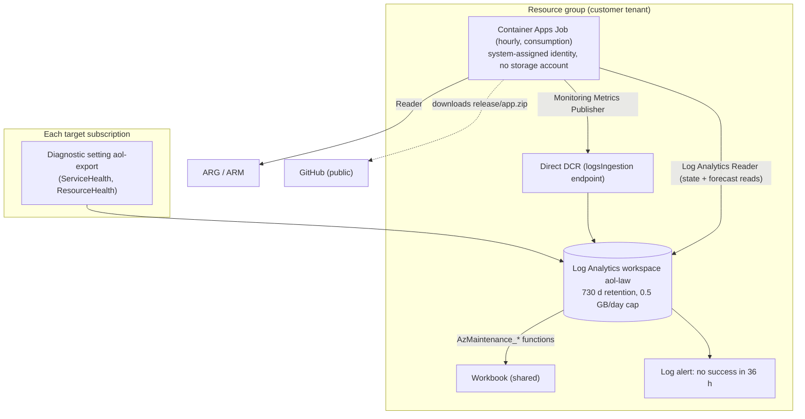

# Architecture

## Components

| Component | Where | Notes |
|-----------|-------|-------|
| Activity Log export | `infra/export.bicep` (subscription scope) | `aol-export`; ServiceHealth + ResourceHealth only |
| Workspace, tables, DCR | `infra/modules/{workspace,tables,dcr}.bicep`, `infra/schemas/tables.json` | tables are Analytics plan; the schema file is the single source for tables and DCR streams |
| Collector job | `infra/modules/collectorjob.bicep`, `src/collector/job.py` | Container Apps Job on the consumption profile, cron `15 * * * *` (UTC). Each run downloads `release/app.zip`, installs `requirements.txt` and runs `python -m collector.job collect`. Environment logs go to the workspace through a diagnostic setting (no keys) |
| What a run does | `src/collector/job.py` | first runs bootstrap step by step (catalog, PIRs, Service Health via ARG and REST, Activity Log history, inventory, VM annotations); afterwards each task runs when due: Service Health and inventory daily, VM annotations every 6 h, PIRs monthly (from day 2), planning ranges daily. Failed tasks fail the job and are retried at the next run |
| State | `src/collector/state.py`, `kql/queries/state_*.kql` | watermarks and "step done" markers are rows in `AzMaintenanceIngestHealth_CL` (`source = state:<key>`, value in `state_value`); "last success" comes from the same table. No storage account is needed |
| Sources | `src/collector/sources/` | `arg.py` (ARG), `rest.py` (Service Health REST, Activity Log REST), `pirs.py` + `pir_parser.py` |
| Ingestion | `src/collector/ingest.py` | `row_key = sha256(source|subscription|key|last_update)`; append-only; retries with backoff + jitter |
| Health | `src/collector/health.py` | every run writes a row to `AzMaintenanceIngestHealth_CL`, success or failure |
| KQL functions | `kql/AzMaintenance_*.kql` -> `infra/modules/kqlfunctions.bicep` | deduplicate with `arg_max(ingested_utc, *) by row_key`; all take `includeSynthetic` |
| Analytics | `src/analytics/` | intervals, classification, availability, forecast, composite SLA (KQL twin: `AzMaintenance_CompositeSla`) |
| Workbook | `tools/build_workbook.py` -> `workbook/workbook.deploy.json` -> `infra/modules/workbook.bicep` | 10 pages |
| Report | `src/reporting/render_report.py` | self-contained HTML + XLSX |

## Why a Container Apps Job and not Azure Functions

Azure Functions needs a storage account the platform can reach. Many governed subscriptions enforce "public network access disabled" on storage accounts with a policy that overrides the template (verified: an explicit `publicNetworkAccess: Enabled` is switched back to Disabled), which makes the Functions code deployment fail with a 403. A Container Apps Job has no storage dependency, stays serverless and costs cents, so the same collector runs everywhere. See decisions D-17 and D-21.

## Tables (see `infra/schemas/tables.json`)

`AzSvcHealthEvents_CL`, `AzSvcHealthImpacted_CL`, `AzVmAnnotations_CL`, `AzResourceHealthEvents_CL`, `AzInventoryCounts_CL`, `AzPublicPirs_CL`, `AzServiceCatalog_CL`, `AzMaintenanceForecast_CL`, `AzMaintenanceIngestHealth_CL`. Every table also has `TimeGenerated`, `ingested_utc`, `row_key`, `is_synthetic`. Two columns differ from the original data model because `title` and `type` are reserved in custom tables: `event_title` and `health_type`.

## Event source precedence

`arg > rest > activitylog` per (subscription, tracking id). ARG is the daily snapshot, REST supplies up to a year of history (ARG only holds ~7 months here), the Activity Log export gives a durable record of every update going forward.

## Security

Managed identity only; no keys, SAS or connection strings; no storage account; least privilege: Reader on the target scope, Monitoring Metrics Publisher on the DCR, Log Analytics Reader on the workspace. The job runs the code in `release/app.zip` downloaded from a public URL at each run: pin `packageUri` to a commit or tag, or fork the repository, to control what runs. No customer data in the repository; fixtures are public PIRs or synthetic.
