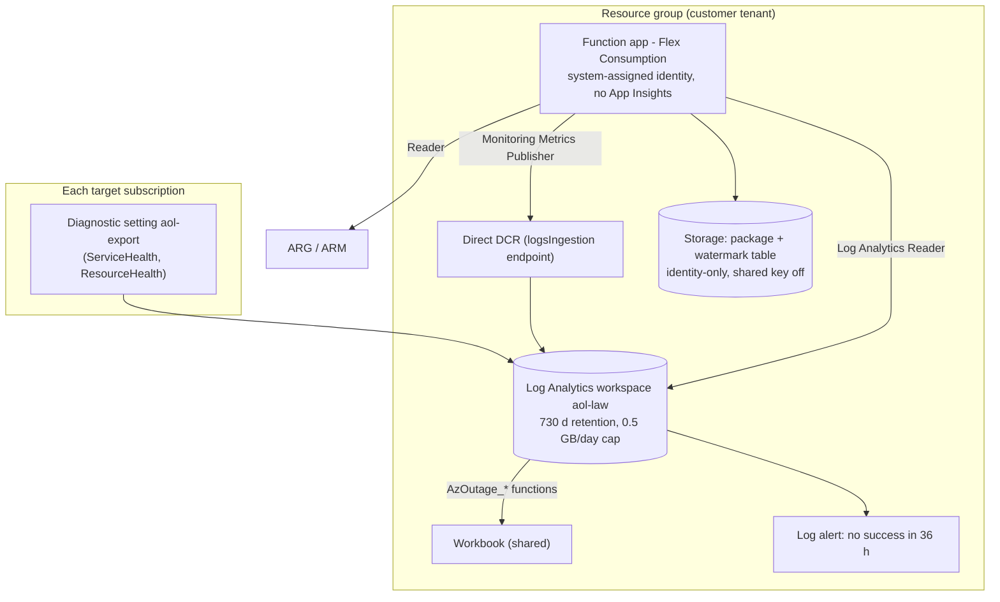

# Architecture

## Components

| Component | Where | Notes |
|-----------|-------|-------|
| Activity Log export | `infra/export.bicep` (subscription scope) | `aol-export`; ServiceHealth + ResourceHealth only; never touches other settings |
| Workspace, tables, DCR | `infra/modules/{workspace,tables,dcr}.bicep`, `infra/schemas/tables.json` | tables are Analytics plan; the schema file is the single source for tables and DCR streams |
| Function app | `infra/modules/functionapp.bicep`, `src/collector/function_app.py` | UTC timers: Service Health 02:15, inventory 02:45, forecast 03:15, VM annotations every 6 h (flag), PIRs day 2 at 03:00 |
| Sources | `src/collector/sources/` | `arg.py` (ARG), `rest.py` (Service Health REST, Activity Log REST), `pirs.py` + `pir_parser.py` |
| Ingestion | `src/collector/ingest.py` | `row_key = sha256(source|subscription|key|last_update)`; append-only; retries with backoff + jitter |
| Watermarks | `src/collector/state.py` | Table Storage with managed identity |
| Health | `src/collector/health.py` | every run writes a row to `AzOutageIngestHealth_CL`, success or failure |
| KQL functions | `kql/AzOutage_*.kql` -> `infra/modules/kqlfunctions.bicep` | deduplicate with `arg_max(ingested_utc, *) by row_key`; all take `includeSynthetic` |
| Analytics | `src/analytics/` | intervals, classification, availability, forecast, composite SLA (KQL twin: `AzOutage_CompositeSla`) |
| Workbook | `tools/build_workbook.py` -> `workbook/workbook.template.json` -> `infra/modules/workbook.bicep` | 10 pages |
| Report | `src/reporting/render_report.py` | self-contained HTML + XLSX |

## Tables (see `infra/schemas/tables.json`)

`AzSvcHealthEvents_CL`, `AzSvcHealthImpacted_CL`, `AzVmAnnotations_CL`, `AzResourceHealthEvents_CL`, `AzInventoryCounts_CL`, `AzPublicPirs_CL`, `AzServiceCatalog_CL`, `AzOutageForecast_CL`, `AzOutageIngestHealth_CL`. Every table also has `TimeGenerated`, `ingested_utc`, `row_key`, `is_synthetic`. Two columns differ from the original data model because `title` and `type` are reserved in custom tables: `event_title` and `health_type`.

## Event source precedence

`arg > rest > activitylog` per (subscription, tracking id). ARG is the daily snapshot, REST supplies up to a year of history (ARG only holds ~7 months here), the Activity Log export gives a durable record of every update going forward.

## Security

Managed identity only; no keys, SAS or connection strings; storage shared-key access disabled; least privilege: Reader on target scope, Monitoring Metrics Publisher on the DCR, Log Analytics Reader on the workspace, storage data roles on the function's own storage account. No customer data in the repository; fixtures are public PIRs or synthetic.
